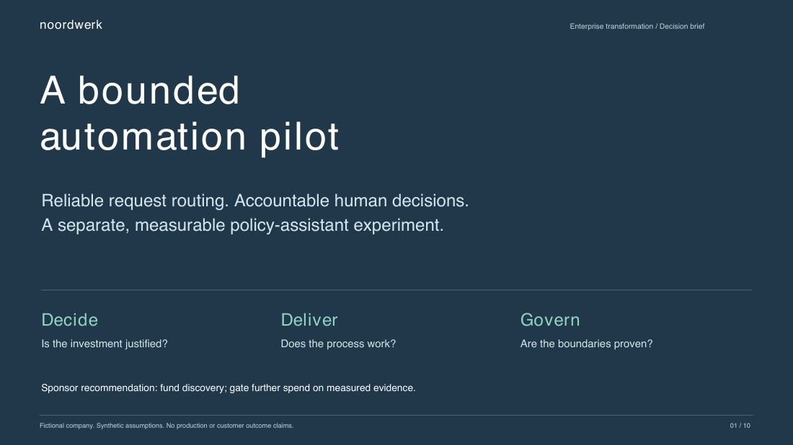
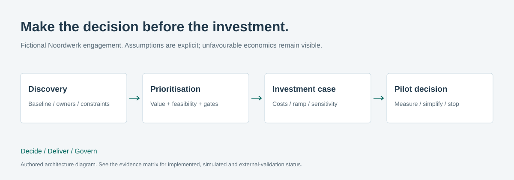

# Noordwerk · AI Transformation Consulting Playbook

**Start here: [Portfolio completion](PORTFOLIO_FINAL.md) · [Five- and ten-minute walkthrough](docs/portfolio-walkthrough.md)**

**A decision-led client engagement: discovery, prioritisation, economics, delivery gates and adoption.**

[](deliverables/noordwerk-executive-brief.pdf)

Noordwerk is a **fictional** 140-person technical services company. This independent
portfolio exercise contains synthetic workshops, assumptions and decisions. It does
not claim a real customer, facilitated engagement, deployment or realised saving.

## The business decision

The company needs a reliable route for material, expense and access requests. The
consulting question is whether software and AI create enough value to justify their
cost and risk. The recommendation is a **bounded rules-only pilot**, with a separate
policy-agent experiment, and explicit conditions for scaling or stopping.

The economics remain unfavourable in year one: **−€7,695 including adoption ramp**,
with first non-negative cumulative cash flow in **month 25**. These are reproducible
assumptions, not measured business outcomes or current Microsoft prices.

## Executive deliverables

| Reviewer's need | Deliverable | Decision supported |
|---|---|---|
| Ten-minute sponsor conversation | [Ten-page executive PDF](deliverables/noordwerk-executive-brief.pdf) | Fund discovery and define pilot gates |
| Discovery and constraints | [Workshop](docs/discovery-workshop.md), [client brief](docs/case-brief.md) | Confirm owner, baseline, rights and scope |
| Options and risk | [Decision brief and risk register](docs/engagement-decision.md) | Compare email improvement, rules, Power Platform and AI |
| Process design | [AS-IS / TO-BE BPMN](process/), [visual architecture](docs/assets/architecture.svg) | Route work and handle exceptions |
| Investment case | [Cost drivers and ramp](docs/financial-assumptions.md), [monthly output](output/investment-case.json) | Separate capacity, realised value, cost and timing |
| Prioritisation | [Use-case CSV](data/use-cases.csv), [gated scoring](playbook.py) | Block unsafe cases regardless of attractive score |
| Delivery and adoption | [Current gated roadmap](docs/requirements-and-roadmap.md), [RACI](docs/delivery-roadmap.md), [KPI / training plan](docs/adoption-and-measurement.md) | Define accountable exit criteria |
| Interview preparation | [English walkthroughs](docs/interview-guide.md) | Explain consulting and technical tradeoffs |

The PDF is a rendered decision presentation with a real Hub screenshot, architecture,
process comparison, cash-flow chart, sensitivity table and roadmap. Its source is
[`scripts/build_executive_pdf.py`](scripts/build_executive_pdf.py). The earlier Dutch
[Markdown slide outline](deliverables/client-presentation.md) is retained as historical
working material; its immediate-benefit economics should not replace the new ramp model.

## Method and architecture



Discovery separates facts, assumptions and decisions. Hard gates reject use cases with
no human owner, no data permission, or unacceptable risk. The deterministic scoring function compares value,
feasibility and readiness. Rules-based routing comes before AI because no language model
is needed to apply a category and amount threshold.

The [Automation Hub](https://github.com/phlppgdfry/enterprise-ai-automation-hub/tree/portfolio/noordwerk-showcase) demonstrates
an employee-to-reviewer workflow. [Agent Governance](https://github.com/phlppgdfry/enterprise-ai-agent-governance/tree/portfolio/noordwerk-showcase)
separately investigates policy evidence selection and documents its failed quality gate.
Microsoft tenant implementation is a target design; no Noordwerk deployment is claimed.

## Reproduce the analysis

Python 3.11+, Make; no third-party runtime dependencies.

```bash
make verify
python3 playbook.py
python3 financial_model.py --output /tmp/investment-case.json
```

`playbook.py` preserves the original immediate-benefit scenario: 42 hours/month capacity,
€595/month net value, −€4,860 in year one and 20.17-month payback. `financial_model.py`
adds reconciled licensing/AI/hosting/support allowances, a 36-month cash-flow schedule,
adoption ramp and nine adoption/cost sensitivities. Recurring cost starts in month 1;
benefits are zero for two months before adoption increases.

Optional PDF regeneration uses ReportLab, a build-only dependency listed in
`requirements-docs.txt`. Runtime verification does not require it:

```bash
python3 scripts/build_executive_pdf.py
# Render and inspect with Poppler:
pdftoppm -scale-to 1100 -png deliverables/noordwerk-executive-brief.pdf /tmp/noordwerk-slide
```

## Tests and evidence

**17 tests** cover the original formulas, NaN/infinity/boolean rejection, hard gates,
reconciled costs, ramp behaviour, no-adoption economics, sensitivity and committed-report
consistency. Documentation and baseline output checks also run in CI.

[Evidence matrix](EVIDENCE.md) · [Executed verification](VERIFICATION.md)
· [Portfolio audit](PORTFOLIO_AUDIT.md) · [Before/after report](TRANSFORMATION_REPORT.md)

## Governance, outcomes and limitations

The sponsor owns the investment decision; Operations owns the process; Finance owns
value realisation and expense policy; IT owns identity, release and recovery; Change
& Adoption owns training and observed use. Security incidents stop the proposed pilot.

All licensing and AI unit costs are **fictional planning allowances**, not vendor quotes.
The model excludes tax, discounting, inflation and seasonality. Freed hours are not
payroll savings. Baseline, adoption, actual model relevance, user task completion,
licensing and tenant security still need independent validation. The PDF contains
selectable text but is not tagged for full accessible-PDF compliance.

[Security](SECURITY.md) · [Discovery template](templates/discovery-notes.md)
· [Pilot review template](templates/pilot-review.md) · [MIT license](LICENSE)

## One client, three complementary cases

**Decide: this playbook** → [Deliver: Automation Hub](https://github.com/phlppgdfry/enterprise-ai-automation-hub/tree/portfolio/noordwerk-showcase)
→ [Govern: Agent Governance](https://github.com/phlppgdfry/enterprise-ai-agent-governance/tree/portfolio/noordwerk-showcase).

[Portfolio strategy](docs/portfolio-strategy.md). No fourth standalone application is
required: the Hub includes a unified portfolio view and links to these deliverables.

## Noordwerk Portfolio v1.0 — Showcase Candidate

See [local release notes](RELEASE_NOTES.md), [the release-candidate verification](RELEASE_VERIFICATION.md), and [code/debugging preparation](docs/code-and-practice.md).
The business-facing entry point is the [Consulting Playbook](https://github.com/phlppgdfry/ai-transformation-consulting-playbook/tree/portfolio/noordwerk-showcase). Historical reports retain their original dates and counts.

The [seven-phase roadmap and acceptance requirements](docs/requirements-and-roadmap.md) supersede the earlier six-week outline. [Named financial scenarios](output/scenarios.json) preserve base −€7,695 / month 25; conservative and optimistic inputs are explicit planning assumptions. Run `python3 scenarios.py` to reproduce.
