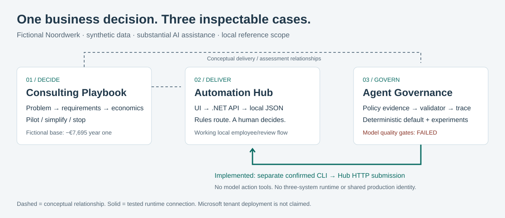
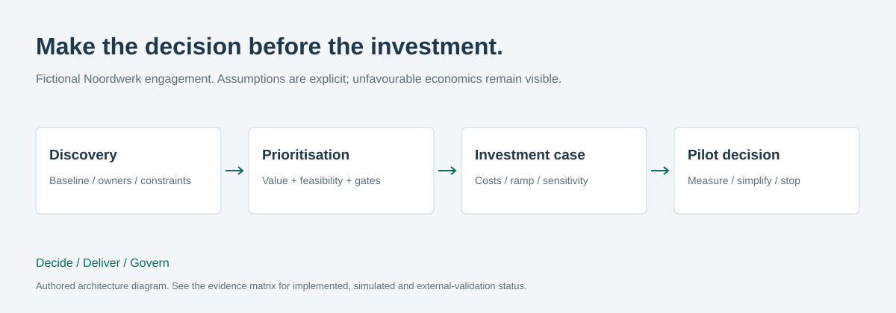

# Architecture in four views

SVG source is editable and needs no Mermaid renderer. These are authored diagrams,
not screenshots. Follow the linked source for implementation detail.

## Portfolio — conceptual relationships versus implemented connection

Dashed lines represent consulting/assessment relationships. The solid Agent CLI → Hub
line is the verified local HTTP submission path. No model is connected to an approval
tool; no runtime integration with the financial analysis exists.

## Automation Hub — implemented local architecture

The API handles validation, routing, owner/resource checks, optimistic decision version
and persisted audit events. The existing UI policy guide explains rules; it is not model
inference. HTTP/storage/browser tests evaluate behavior rather than a separate runtime
evaluation service. Local audit/history is observability evidence, not OpenTelemetry or
cloud monitoring. [Source and tradeoffs](https://github.com/phlppgdfry/enterprise-ai-automation-hub/blob/main/docs/architecture.md).

## Governance — source scope, validation and authority

This retained diagram illustrates v1 exact source/summary validation. V2 proposes only
an allowed ID and renders text in code. Neither proves relevance; traces record outcomes
and usage. Risk/refusal checks are deterministic safeguards, not model reasoning. A
separate explicitly confirmed CLI may submit to Hub; human decision authority stays in
the Hub API. [Actual v1/v2 architecture](https://github.com/phlppgdfry/enterprise-ai-agent-governance/blob/main/docs/model-architecture.md).

## Consulting — the actual decision methodology

Read the flow as business problem → discovery → feasibility/hard gates → risk/options →
reproducible business case → go/no-go. The [seven phases](../requirements-and-roadmap.md)
make discovery, process validation, prototype, pilot, independent evaluation, decision and
conditional rollout explicit. A future-state process is a proposal, not proof all steps
are automated. [AS-IS and TO-BE BPMN](../../process/) preserve human approval and exceptions.
