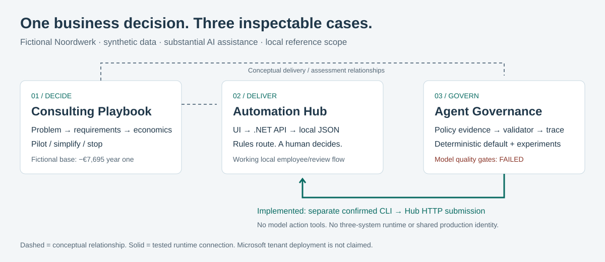

# Enterprise AI — Strategy, Automation, Governance & Evaluation

**One fictional business decision, a working local workflow and an honest AI experiment.**
For recruiters, analysts and engineering reviewers. Developed with substantial AI
assistance; personal contribution and independent understanding require owner confirmation.

[Four architecture views](ARCHITECTURE_GUIDE.md) · [Recording scripts and assets](VISUAL_ASSETS_PLAN.md)

## Executive overview

Noordwerk is a fictional 140-person technical services company. Materials, expenses and
access requests arrive by email; ownership and approval reasons become hard to follow.
The case asks what should be automated, who remains accountable and whether the investment
is justified. The answer is a bounded rules-only pilot, with model assistance kept experimental.

| Project | Problem / implemented response | Inspect in under a minute |
|---|---|---|
| [Strategy: Playbook](../../README.md) | Translate synthetic requirements into acceptance criteria, process models, cost/ramp/scenarios and a go/no-go decision | [Executive PDF](../../deliverables/noordwerk-executive-brief.pdf), [requirements](../requirements-and-roadmap.md) |
| [Automation: Hub](https://github.com/phlppgdfry/enterprise-ai-automation-hub) | Route requests deterministically, preserve human review and make status/history visible | [Actual UI](https://github.com/phlppgdfry/enterprise-ai-automation-hub/blob/main/docs/assets/hub-overview.png), [API source](https://github.com/phlppgdfry/enterprise-ai-automation-hub/blob/main/src/Program.cs) |
| [Governance: Agent](https://github.com/phlppgdfry/enterprise-ai-agent-governance) | Filter synthetic policy evidence, validate model proposals and evaluate failure | [Frozen evaluation report](https://github.com/phlppgdfry/enterprise-ai-agent-governance/blob/main/eval/RELEASE_REPORT.md) |

## Architecture and actual integration

The Hub is ASP.NET Core 10 plus same-origin authored HTML/CSS/JavaScript and a local JSON
store. The API owns identity-fixture mapping, ownership, routing, state changes and writes.
Python implements the independent policy reference, optional fixed-loopback Ollama provider
and financial analysis. Small approved policy excerpts fit in context; no vector database
or orchestration framework is justified.

The **separate, explicitly confirmed Agent CLI can submit to the Hub over real local HTTP**.
Its integration test verifies idempotency, Bob's denial and Maria's human decision. The
model receives no action tools. There is no shared production identity, deployed agent
service, automatic business-case synchronisation or three-system runtime. Connections
from business assessment to software/evaluation are conceptual delivery relationships.

## Capability status

| Status | Scope |
|---|---|
| Implemented and tested | Local request/decision/history, deterministic routing, owner checks, retry/conflict/persistence tests, confirmed HTTP submission, financial calculations |
| Demonstration / synthetic | People, tokens, policy documents, operational records, workshop/stakeholder and financial inputs |
| Experimental with failed gates | Genuine recorded local Qwen inference; holdout v1 22/32, v2 21/32 overall; source validity does not establish relevance |
| Architectural concept | Entra identity, managed Power Platform solutions, Dataverse, Teams/SharePoint and tenant ALM handoff |
| Not claimed | Production customer, deployed Noordwerk tenant, autonomous approval, measured savings, independent model assurance |

## Business relevance and limits

The base model yields **−EUR 7,695 year one and payback month 25** with explicit adoption
assumptions. Capacity released is not cash saved. This supports a smaller pilot with measured
cost and adoption, or a decision to defer; it does not justify selling a positive ROI story.
Human process ownership and rejection/exception handling are as important as happy-path UX.

Public fixture identities are not real authentication. Local atomic JSON writes are not
distributed transactions, protected audit or verified recovery. Microsoft handoff artifacts
are offline designs. Chromium evidence is not full accessibility or user validation.

## Evidence and interview route

Start with [the five-/ten-minute walkthrough](../portfolio-walkthrough.md), then inspect
[the code knowledge map](../code-and-practice.md), [verification matrix](../../EVIDENCE.md)
and [reproducibility](../reproducibility.md). Use [the three-level interview guide](INTERVIEW_PREPARATION.md)
to explain why rules were chosen, where authorization lives, why both model gates failed,
and how negative economics change the management recommendation.

Ask the owner which decisions they personally made and can reproduce independently.
Repository artifacts support discussion; they cannot answer those autobiographical questions.
