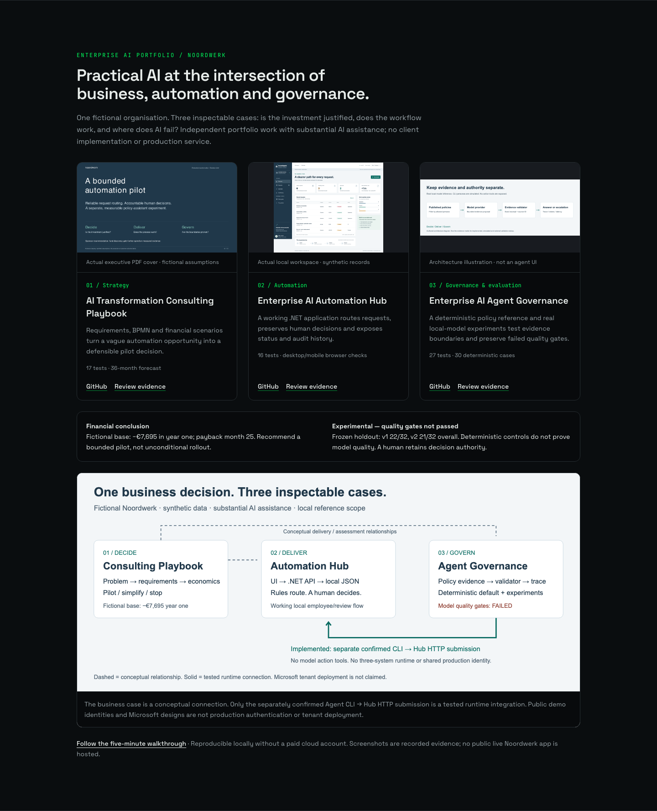

# Website section — local review handoff

> Historical handoff. Superseded on 9 November 2026 by [the finalization report](../../ENTERPRISE_AI_PORTFOLIO_FINALIZATION_REPORT.md): current main was integrated, Router advisories resolved, and website draft PR #3 passed CI. Production still requires owner approval.

Source identified: `phlppgdfry/pgosprive`, React/Vite, existing dark/green visual language
and English/Dutch switcher. The separate accounting/enterprise AI case is not Noordwerk.
The public site was read-only inspected with installed Chromium after the web tool and
native bridge failed. Its current entry page has no Noordwerk section. No production
website change, deployment or live public demo was performed.

## Prepared implementation

Local branch `showcase/noordwerk-portfolio` in the dedicated worktree
`noordwerk-website-review`, based on website commit `704815a`. Files:

- `src/components/portfolio/EnterpriseAiPortfolio.tsx`: localized responsive section;
  three evidence cards, financial/AI limitations, conceptual/runtime diagram and walkthrough.
- `src/pages/Home.tsx`: section before featured work; `SiteNav.tsx`: direct navigation.
- `public/work/noordwerk-*`: copies of existing authored/real assets; no remote image dependency.
- `package-lock.json`: repaired existing manifest mismatch so clean installation can be checked.

No declared dependency or new backend was added. The Agent card explicitly labels its
image as architecture, not UI. Test counts describe deterministic tests, not model scores.
Links use already-published main evidence; there is no misleading live-demo button.
The overview is horizontally scrollable and keyboard focusable on narrow screens so
diagram text remains legible. The full page itself should not overflow.

[Mobile capture](assets/website-mobile.png) and the local browser report document actual
preview behavior. These captures are a prepared website branch, not screenshots of a
published new section. Captures show synthetic/source-backed artifacts and no credentials.

## Verification and publication boundary

Run `npm ci --ignore-scripts`, `npm run build`, `npm test`, then targeted ESLint on the
three changed TSX files. Run `npm run dev -- --host 127.0.0.1 --port 5181 --strictPort`
for a local preview at `http://127.0.0.1:5181/#enterprise-ai`.
No dependency on globally installed Vite is intended.

Full existing lint reports errors in unchanged `command.tsx`, `textarea.tsx` and
`tailwind.config.ts`. The resolved dependency tree also reports critical/high advisories.
Do not infer deployment approval from build or targeted-lint success. See the closure
report for executed results. A separate dependency/security decision is needed before
publishing this website candidate; no force-fix or broad upgrades were performed here.

Concurrent work modified the original website checkout's branch/project catalogue.
Only this task's exact component/Home/nav/assets were moved to the isolated worktree;
the other work was preserved and is excluded from this candidate. Do not commit the
other workstream's sitemap, accounting image or project JSON as part of Noordwerk.

Prepare a website PR only after reviewing the isolated diff, security advisories,
existing deployment configuration and current main. The source has a main CI workflow;
hosting/deployment integrations were not exhaustively verified, so this branch has not
been pushed. Owner approval is required before production deployment. No paid service
or fourth portfolio application is necessary.
